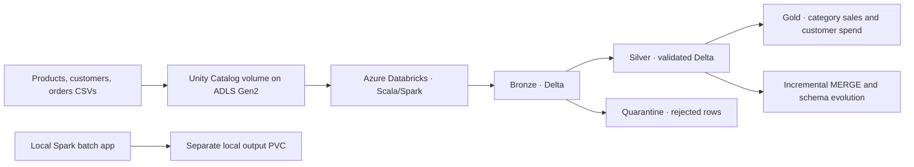
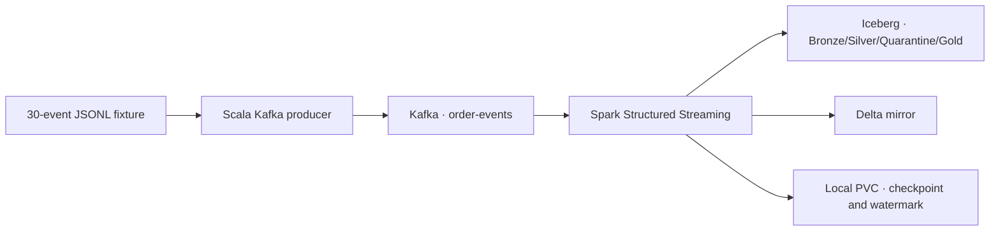

# Retail Lakehouse Architecture

## Batch processing

The Databricks notebook is the primary batch workflow. The local Spark app demonstrates the base products/customers/orders processing and does not replace the notebook's incremental merge or schema-evolution stages.

## Streaming

Kafka, Spark, Iceberg, and the stream state in this demonstration run locally. The PVC is not an ADLS-backed production store. Databricks batch tables and their Unity Catalog volume were verified as ADLS Gen2-backed; explicit raw/curated/rejected/analytics `abfss` zones remain a separate verification item.

For table names and operating constraints, see the [design notes](../docs/solution-design.md) and [requirements/evidence matrix](../docs/requirements-compliance.md).
