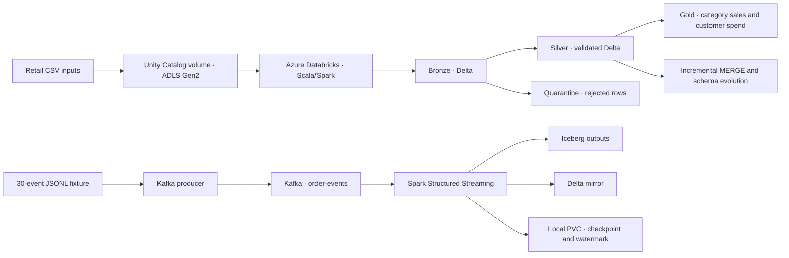

# Project Nexus

**Retail medallion lakehouse for historical sales and real-time order events**

## Project overview

Project Nexus combines Azure Databricks batch analytics with a local Kafka and Spark Structured Streaming demonstration. The pipelines validate product, customer, order, and event data into Bronze, Silver, Quarantine, and Gold outputs. Delta Lake is used for batch tables and streaming copies; Apache Iceberg demonstrates streaming snapshots, schema evolution, and time travel.

The Databricks batch workflow is the primary historical pipeline. A separate local Spark batch app and Docker/Kubernetes manifests demonstrate processing the base CSV inputs without replacing the notebook's incremental `MERGE` or schema-evolution stages.

Start with the [architecture](#architecture), [demo guide](docs/demo-guide.md), or [requirements and evidence matrix](docs/requirements-compliance.md).

## Technology stack

| Area | Technology |
|---|---|
| Batch processing | Azure Databricks, Scala, Apache Spark, Unity Catalog |
| Streaming | Apache Kafka and Spark Structured Streaming on local Kubernetes |
| Storage and table formats | ADLS Gen2-backed Unity Catalog volume, local PVC, Delta Lake, Apache Iceberg |
| Deployment | Docker, Kubernetes Jobs and Deployments, ConfigMaps and PVCs |
| Analytics and verification | Databricks SQL, Spark SQL, sbt tests, GitHub Actions |

## Repository contents

| Section | What to open |
|---|---|
| [Architecture](Architecture/README.md) | Batch/streaming diagrams and cloud/local boundaries |
| [Datasets](Datasets/README.md) | Retail input layout, sample event fixture, and data dictionary |
| [Data Ingestion](Data%20Ingestion/README.md) | Databricks notebook, Spark apps, and Kafka producer |
| [Dashboard](Dashboard/README.md) | Gold tables and business SQL queries |
| [Development](Development/README.md) | Dockerfiles, Kubernetes manifests, and build contexts |
| [Logging](Logging/README.md) | Runtime-log locations and evidence status |
| [Testing](Testing/README.md) | Test suites, screenshot evidence, and validation command |
| [Project documentation](docs/requirements-compliance.md) | Requirements status and outstanding evidence |

## Architecture



The streaming PVC is local Docker Desktop storage, not ADLS. See [Architecture/README.md](Architecture/README.md) for the separate batch, local batch, and streaming flows.

## Dataset

| Input | Baseline rows | Repository status |
|---|---:|---|
| Products | 27 | Source CSV not checked in |
| Customers | 42 | Source CSV not checked in |
| Orders | 161 | Source CSV not checked in |
| Kafka order-event fixture | 30 | Included under `Datasets/streaming/order-events/` |

The Databricks notebook also uses separate incremental-update and schema-evolution CSVs. The authorized source CSVs must be available in the configured Unity Catalog volume (or staged separately for the local batch demo); this repository does not fabricate replacement inputs.

## Medallion architecture and analytics

| Layer | Project output |
|---|---|
| Bronze | Raw batch entities and streaming order events with ingestion metadata |
| Silver | Typed, deduplicated and enriched products, customers, and orders |
| Quarantine | Rejected batch rows and invalid, duplicate, or late streaming events |
| Gold | `gold_category_sales`, `gold_customer_spend`, and the streaming revenue-window aggregate |

The batch Gold tables exclude cancelled orders. Category sales are grouped by category and sales channel; customer spend is grouped by customer. See the [query catalogue](Dashboard/README.md) and [SQL examples](Dashboard/business-queries.sql).

## Run the project

Unless a command changes directory, run it from the repository root. See the [demo guide](docs/demo-guide.md) for complete procedures and safeguards.

## Run the batch notebook

1. Import [01_bronze_ingestion.scala](<Data Ingestion/Batch/01_bronze_ingestion.scala>) and [00_batch_helpers.scala](<Data Ingestion/Batch/00_batch_helpers.scala>) into the same Databricks workspace folder; the notebook uses `%run ./00_batch_helpers`.
2. Set `batch_input_path` to `/Volumes/nexus/default/retail_nexus_volume/batch`, `target_catalog` to `nexus`, `target_schema` to a writable validation schema, and `run_date` to `yyyy-MM-dd`.
3. Run the notebook and review the Bronze counts, Silver and Quarantine outputs, Gold tables, and Delta history.

For trainer Job/Workflow evidence, create a parameterized notebook Job and save its run status, duration, parameters, counts, schema, and table locations. The revised Job run has not yet been captured.

## Run the portable batch job

Stage the three authorized base CSV files as `products.csv`, `customers.csv`, and `orders.csv` under `Data Ingestion\Batch\batch-input`. Then build the image using the module as the context:

```powershell
Push-Location '.\Data Ingestion\Batch'
docker build -t nexus-batch:1.0 -f ..\..\Development\Docker\nexus-batch.Dockerfile .
Pop-Location
```

Run the one-shot Kubernetes Job only after staging the real inputs. The prepared Job writes to its own output PVC and does not use or change the streaming PVC, checkpoint, or Kafka topic:

```powershell
Push-Location '.\Data Ingestion\Batch'
kubectl create configmap nexus-batch-data -n streaming `
  --from-file=products.csv=.\batch-input\products.csv `
  --from-file=customers.csv=.\batch-input\customers.csv `
  --from-file=orders.csv=.\batch-input\orders.csv `
  --dry-run=client -o yaml | kubectl apply -f -
Pop-Location
kubectl apply -f .\Development\Kubernetes\batch-pvc.yaml
kubectl apply -f .\Development\Kubernetes\batch-config.yaml
kubectl delete job nexus-batch -n streaming --ignore-not-found
kubectl apply -f .\Development\Kubernetes\batch-job.yaml
kubectl wait --for=condition=complete job/nexus-batch -n streaming --timeout=10m
kubectl get jobs,pods,pvc -n streaming
kubectl logs -n streaming job/nexus-batch
```

Do not add a CronJob until the one-shot Job succeeds. See the [requirements matrix](docs/requirements-compliance.md) for current evidence status.

## Run the Kafka event producer

The five JSONL files contain 30 sample events. Producer tests run without Kafka. From the repository root:

```powershell
Push-Location '.\Data Ingestion\Producer'
sbt test
sbt run --once
Pop-Location
```

To build the producer container, use the repository root as the build context so the event fixture is included:

```powershell
docker build -t nexus-kafka-producer:1.0 -f .\Development\Docker\nexus-producer.Dockerfile .
```

The existing production-topic sample has already been processed. Do not rerun the producer against `order-events` when preserving the verified offsets and streaming output.

## Run real-time streaming locally

The streaming app uses the existing Kafka Service, reference-data ConfigMap, persistent streaming PVC, checkpoint, and watermark. Build the application image from its module directory, then apply the centralized Kubernetes files:

```powershell
Push-Location '.\Data Ingestion\Streaming'
sbt test
sbt package
Copy-Item .\target\out\jvm\scala-2.12.18\kafkastreamingicebergdemo\kafkastreamingicebergdemo_2.12-0.1.0-SNAPSHOT.jar .\target\app.jar -Force
docker build -t nexus-streaming:1.0 -f ..\..\Development\Docker\nexus-streaming.Dockerfile .
Pop-Location
kubectl apply -f .\Development\Kubernetes\streaming-state-pvc.yaml
kubectl apply -f .\Development\Kubernetes\streaming-config.yaml
kubectl apply -f .\Development\Kubernetes\streaming-deployment.yaml
kubectl rollout status deployment/nexus-streaming -n streaming --timeout=8m
kubectl get deployments,pods,pvc -n streaming
kubectl logs -n streaming deployment/nexus-streaming --tail=100
```

The Kafka broker and reference-data ConfigMap are prerequisites provided by the existing local environment. Preserve the PVC and checkpoint during recovery; never reset the cluster or rerun the production-topic producer just to demonstrate recovery. The [live demo checklist](docs/live-demo-checklist.md) has safe walkthrough steps.

### Verify the running stream

The verifier is read-only. Run it against the deployed application to inspect table counts, schema, and Iceberg history:

```powershell
kubectl exec -n streaming deployment/nexus-streaming -- env `
  ICEBERG_WAREHOUSE=file:///lakehouse/warehouse `
  DELTA_WAREHOUSE=file:///lakehouse/delta/retail_nexus `
  SPARK_MASTER=local[1] `
  /opt/spark/bin/spark-submit --master "local[1]" --driver-memory 512m `
  --conf spark.jars.ivy=/lakehouse/ivy2 `
  --conf spark.sql.extensions=org.apache.iceberg.spark.extensions.IcebergSparkSessionExtensions,io.delta.sql.DeltaSparkSessionExtension `
  --conf spark.sql.catalog.spark_catalog=org.apache.spark.sql.delta.catalog.DeltaCatalog `
  --packages org.apache.iceberg:iceberg-spark-runtime-3.5_2.12:1.12.0,io.delta:delta-spark_2.12:3.3.2 `
  --class com.demo.VerifyProjectNexusIceberg /opt/project-nexus/app.jar
```

## Run the Kubernetes replay

The producer Job replays the checked-in 30-event fixture to `order-events`. That fixture has already been processed in the verified environment, so do not rerun this Job against the existing topic when preserving its offsets and table counts. The Job and isolated scaling Deployment are under [Development/Kubernetes](Development/README.md).

The separate producer scaling Deployment is configured for `order-events-scaling-demo` and does not feed the streaming consumer. Follow the [demo guide](docs/demo-guide.md) for a controlled replay or scaling demonstration; do not point that Deployment at `order-events`.

## Run the continuous consumer on Kubernetes

The `nexus-streaming` Deployment continuously polls Kafka with a five-second Spark processing-time trigger. Its PVC stores the checkpoint, Iceberg and Delta data, and the 10-minute event-time watermark. A trigger interval schedules micro-batches; it is not an end-to-end latency guarantee. Preserve the PVC when replacing a pod so the consumer resumes from its checkpoint.

## Assumptions and limits

- The original retail CSVs are external inputs and are not present in this checkout.
- Databricks batch storage is ADLS Gen2-backed. The local streaming warehouse, checkpoint, and watermark are on a Kubernetes PVC.
- Streaming uses a plaintext local Kafka example. Do not commit credentials; authenticated deployments should use Kubernetes Secrets or an approved secret store.
- The repository has no dbt project, standalone BI dashboard, or centralized log-storage service. Transformations are Scala/Spark; query Gold tables in Databricks SQL; read current Kubernetes output using `kubectl logs`.
- Explicit ADLS `abfss` raw/curated/rejected/analytics zone verification and a revised parameterized Databricks Job run are still outstanding.

## Delta Lake and Iceberg

Delta Lake provides the Databricks batch tables and streaming copies; Iceberg demonstrates streaming table snapshots, schema evolution, and historical reads. The comparison and scope notes are in [delta-vs-iceberg.md](docs/delta-vs-iceberg.md).

## Validate locally

Run the Scala test suites (the validation script reports the Windows `winutils.exe` limitation where applicable):

```powershell
powershell -NoProfile -ExecutionPolicy Bypass -File .\Testing\validate-project.ps1
```

Batch Spark integration tests run in the Linux Docker build stage and GitHub Actions. Local Windows execution may require Hadoop `winutils.exe`; see [Testing](Testing/README.md).

## Hosted CI

The [CI workflow](.github/workflows/ci.yml) tests the batch helpers, batch app, streaming app, and producer; builds the workload images; and validates Kubernetes manifests. The last recorded successful workflow before this local repository-layout update is [run #14](https://github.com/Harshita-codes/Project-Nexus-Retail-Lakehouse/actions/runs/45190052284). This layout update has not yet been pushed, so it has not been validated by a new hosted run.

## Recorded outcomes

- Baseline batch evidence: Bronze 27 products, 42 customers, and 161 orders; final Silver orders 104. Screenshots are in [Testing/evidence/batch](Testing/evidence/batch/).
- Streaming verification: Bronze/Silver/Quarantine/Gold counts of 30/12/16/8 in both Delta and Iceberg; production Kafka offsets remained `0:8`, `1:13`, and `2:9`. Screenshots are in [Testing/evidence/streaming](Testing/evidence/streaming/).
- Local Kubernetes operational checks were run and verified. Separate terminal log files for those checks are not archived in this repository; see [Logging](Logging/README.md).
- The team presentation/live demo and the remaining Databricks and real-input batch evidence are tracked in [requirements-compliance.md](docs/requirements-compliance.md).
