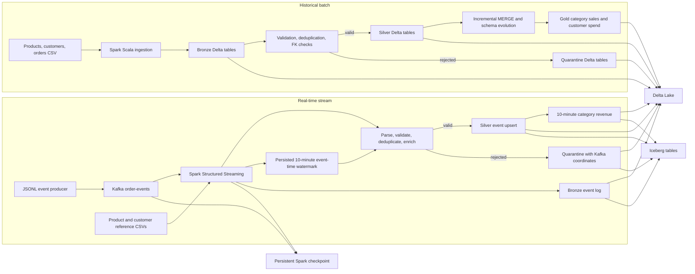

# Solution Design

## Architecture

## Storage and deployment choices

- The batch notebook uses Unity Catalog Delta tables and a managed Databricks Volume. Azure metadata checks confirmed that the volume and Delta table are backed by ADLS Gen2 (`abfss://`) storage. The project does not configure a separate customer-managed external location or storage credential.
- The local streaming app maintains Iceberg tables and mirrors all four layers to path-based Delta tables under `DELTA_WAREHOUSE`. Missing Delta copies are initialized from the current Iceberg state, allowing an existing Kafka checkpoint to continue without republishing the sample events.
- The local deployment stores both streaming formats and the checkpoint on one persistent Docker Desktop PVC. The pod runs Spark in local mode as a single replica; the PVC is not a cloud durability or multi-writer solution.
- A monotonic maximum event time is stored at `/lakehouse/watermark/event-time-watermark.txt`; the 600-second cutoff is restored on restart. Bronze is written before validation, so an event past the cutoff is retained raw and quarantined rather than silently discarded.
- Delta Bronze and Quarantine appends carry a stable application ID and micro-batch transaction version. Iceberg Bronze and Quarantine merges use Kafka partition and offset as replay-stable keys.
- Silver and Gold Delta outputs are refreshed from Iceberg state on each successful batch. This keeps the demo simple and reproducible but rewrites the current snapshot and is not suitable for a high-volume production workload.

## Reliability and security

The Spark checkpoint and Iceberg/Delta warehouses must remain on persistent storage. Do not reset the local Kubernetes cluster or delete the PVC before preserving evidence. The two formats do not share a distributed transaction; recovery uses idempotent writes and replay-safe keys, but a failed batch may temporarily leave the formats at different committed versions until retry completes.

The local Kafka broker uses plaintext without authentication. Do not copy that setting to a production environment; use TLS/SASL and managed secrets there.

## Efficiency opportunities

1. Replace full Delta Silver/Gold refreshes with incremental Delta `MERGE` or transactionally managed writes, and benchmark the change on the same input and compute.
2. Reduce repeated Spark actions in each micro-batch by persisting validated event data and reusing computed counts.
3. Broadcast small reference dimensions only when measured size and query plans show that doing so improves joins.
